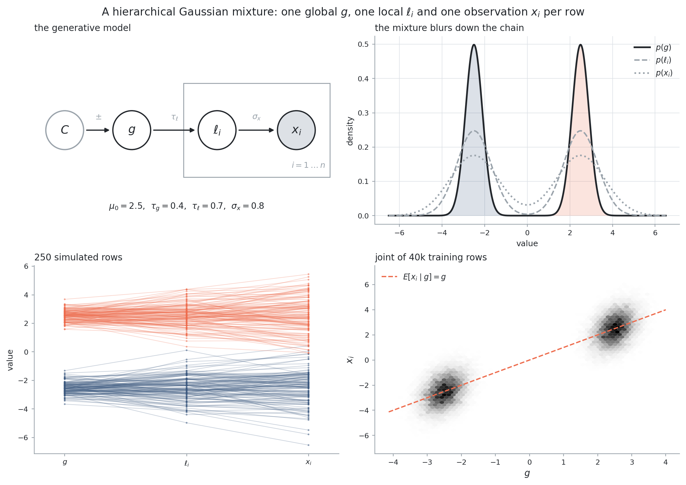
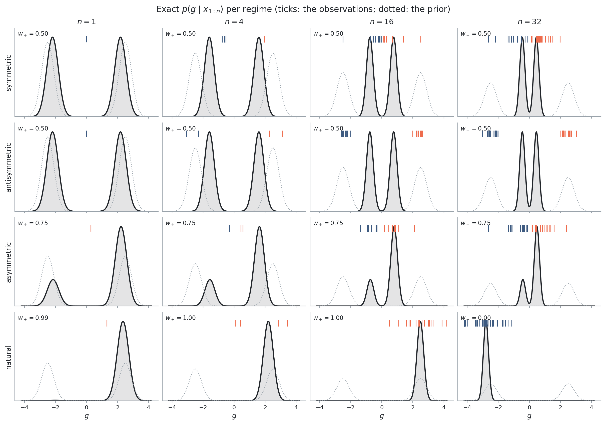
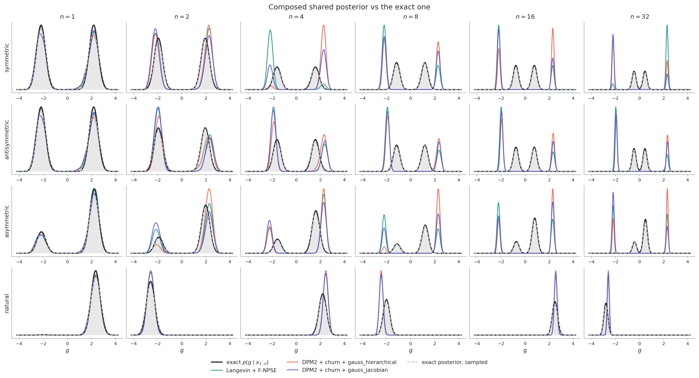
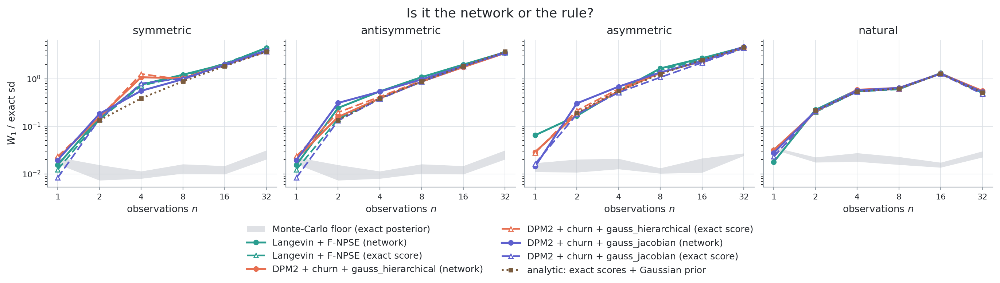

# Gaussian mixtures: compositional score modelling with an exact target

A hierarchical benchmark whose **tall posterior is known in closed form at every
`n`**, built to measure how COMPASS's composition rules scale with the number of
observations when the answer they are aiming at is not in doubt.

```
C  ->  g  ->  l_i  ->  x_i          i = 1 .. n

C ~ {-,+}                (prior mixture component)
g | C = c  ~  N(c mu_0, tau_g^2)          mu_0 = 2.5,  tau_g = 0.4
l_i | g    ~  N(g, tau_l^2)               tau_l = 0.7
x_i | l_i  ~  N(l_i, sigma_x^2)           sigma_x = 0.8
```

Marginalising the local parameter gives `x_i | g ~ N(g, v)` with
`v = tau_l^2 + sigma_x^2`, so **conditioned on the component the whole model is
jointly Gaussian**. The tall posterior `p(g, l_1..l_n | x_1..x_n)` is therefore an
exact two-component Gaussian mixture in `n + 1` dimensions, for every `n`:

* the shared marginal is `w_- N(g; m_-, V) + w_+ N(g; m_+, V)` with
  `V = (1/tau_g^2 + n/v)^-1` and `m_c = V (c mu_0/tau_g^2 + sum_i x_i / v)`;
* each local marginal is a two-component mixture with means `a m_c + b x_i`,
  where `q = (1/tau_l^2 + 1/sigma_x^2)^-1`, `a = q/tau_l^2`, `b = q/sigma_x^2`;
* the full branch covariance is `Var(g) = V`, `Cov(g, l_i) = a V`,
  `Var(l_i) = q + a^2 V`, `Cov(l_i, l_j) = a^2 V`.

**The number of modes does not grow with `n`.** That is the property that makes
this a clean scaling test: whatever a rule loses at `n = 32` it lost to the
composition, not to a target that got harder.

Everything above is implemented and *checked against brute force* in
`model.py` / `tests/test_model.py` -- numerical integration of the joint, and a
400k-draw Monte Carlo of the branch mixture. Nothing downstream trusts algebra
that has not been re-derived a second way.

## The asymmetry knob, and why the sweep is built around it

Writing `T = sum_i x_i`, the posterior branch log-odds are exactly

```
log(w_+ / w_-) = log(pi_+ / pi_-) + 2 mu_0 T / (v + n tau_g^2).
```

Two things follow. First, with a balanced prior the shared posterior is
**symmetric if and only if `T = 0`** -- a measure-zero coincidence, so a rule
graded only on symmetric data is graded on the one configuration where a
symmetrising bias is invisible (this is the failure
`inverse_kinematics/docs/nonsymmetric_composition.md` measured on the arm).
Second, the map from `T` to the branch split is invertible, so a dataset with a
*prescribed* split can be built at any `n`. `datasets.py` uses that to hold the
shape of the target fixed while only `n` changes:

| regime | construction | exact target |
|---|---|---|
| `symmetric` | observations scattered about 0, shifted to `T = 0` | `w_+ = 0.50`, two equal branches |
| `antisymmetric` | observations in `+-` pairs near `+-mu_0`, shifted to `T = 0` | `w_+ = 0.50` again, but every *single* observation is one-sided (`w_+ < 0.02` or `> 0.98`) |
| `asymmetric` | shifted to the `T` that gives the prescribed split | `w_+ = 0.75` at **every** `n` |
| `natural` | a plain prior-predictive draw, no shift | collapses onto one branch by `n = 4` |

`antisymmetric` is the sharpest of the four, and for a stronger reason than "it
looks harder". `(n, T)` is a **sufficient statistic** for the shared posterior:
`V` depends only on `n`, and `m_c` and the weights only on `T`. So `symmetric`
and `antisymmetric` at the same `n` do not merely have similar targets -- they
have *the same density*, reached in one case from evidence that all points the
same way and in the other from evidence that violently disagrees. Any difference
between a method's answers on the two is pure path dependence, in a case where
the truth says the path cannot matter.

Shifting the observations by a constant changes *which dataset is conditioned
on*, not the model; the posterior stays exact for the data the sampler is
handed.





## What is compared

One network, trained on **single observations only** (`train.py`): three nodes
`(g, l, x)`, tokenized trunk, `six_weighted` mask menu, `log_sigma` time
sampling, VESDE `sigma = 15`. Nothing about the tall problem enters training, so
every cross-observation statement below is the composition rule's doing.

Three rules are run by default (`methods.py`):

| arm | what it does |
|---|---|
| `langevin_fnpse` | annealed Langevin on Geffner et al.'s bridging densities, 10 corrector steps per level |
| `gauss_hierarchical` | GAUSS generalised to a global/local hierarchy, pilot covariance from the network's own draws; DPM2 predictor with churn `eta = 4` |
| `gauss_jacobian` | the same composition, curvature from the network's Jacobian by Tweedie's second-order identity -- no pilot run; DPM2 + churn `eta = 4` |

Two further arms exist as diagnostics and must be asked for with `--methods`:

* `gauss_jacobian_mixture_prior` -- identical to `gauss_jacobian` except that the
  `(n-1)`-times-subtracted **diffused prior score is the exact mixture one**
  instead of the moment-matched Gaussian `N(0, 2.53)` the sampler API forces.
  A Gaussian mixture diffuses in closed form, so this term is available exactly;
  the arm isolates how much of the composed error is the prior misspecification
  alone.
* `marginal_product` -- no composed score at all: the exact factorisations
  `p(g | x_1..n) ∝ p(g)^(1-n) prod_i p(g | x_i)` and
  `p(g, l | x) = p(g | x_1..n) prod_i p(l_i | g, x_i)`, assembled from two
  ordinary amortized sampler calls with the **exact mixture prior** on a grid.

### Two controls that remove the network from the question

A composed error measured on a trained network has two possible causes and the
sweep alone cannot separate them: the network's score error, amplified by the
composition, or the composition itself. Both are removed here.

`prior_ablation.py` -- **analytic**. The per-observation posteriors are the exact
closed-form ones and the composed density is integrated from
`sum_i s(g|x_i) - (n-1) s_prior(g)` on a grid, with either the exact mixture
prior or the moment-matched Gaussian. No network anywhere.

`run_scaling.py --oracle` (`oracle.py`) -- **inside the real sampler**. The joint
`(g, l, x)` is itself a two-component Gaussian mixture, so the diffused
conditional `p_t(latent | observed)` is a two-component Gaussian mixture for
*any* condition mask, at every diffusion time. That closed form is served to the
samplers in the network's place, in the network's own `raw / sigma_t`
convention and written in torch so `gauss_jacobian`'s autograd curvature is
exact too. Whatever a rule then returns is its own error, with no network error
in it at all. Checked three ways in `tests/test_oracle.py`: against a numerical
derivative of the exact diffused density for four masks x three times, against
an independently written NumPy conditioning, and end to end -- the ordinary
sampler driven by the oracle reproduces the closed-form single-observation
posterior.

### The measurement's own floor

`run_scaling.py` also runs an `exact_mc` arm: the same number of draws taken
*from the true posterior* and graded by the identical code. Every reported error
is read against that band, never against zero -- a difference below the floor is
not a result.

## Results

Trained network: 268,545 parameters, 200k simulations, early-stopped at epoch 37.
All numbers are W1 to the exact shared posterior in units of that posterior's own
sd, median over 3 replicates. Full tables in `artifacts/scaling/`.

### 1. The single-observation posterior is essentially perfect; composition is not

At `n = 1` every rule sits at the Monte-Carlo floor (0.014-0.036 against a floor
of 0.015-0.036) -- there is no meaningful network error to amplify. From `n = 2`
the composed error grows roughly linearly in `n`: ~75x the floor at `n = 8`, and
~150x at `n = 32`.

| n | floor | Langevin+F-NPSE | gauss_hierarchical | gauss_jacobian |
|---|---|---|---|---|
| 1 | 0.022 | 0.015 | 0.021 | 0.020 |
| 2 | 0.008 | 0.151 | 0.157 | 0.184 |
| 4 | 0.009 | 0.753 | 1.078 | 0.558 |
| 8 | 0.013 | 1.216 | 1.026 | 0.979 |
| 16 | 0.014 | 2.022 | 1.979 | 1.995 |
| 32 | 0.029 | 4.481 | 3.740 | 3.941 |

(`symmetric` data, `n = 32` at 2,000 draws rather than 4,000 -- see below; the
other regimes are within ~30%.) The three rules are
indistinguishable from each other at this scale of error -- **which rule you pick
is not the question on this problem.**

The shape of the failure is visible in `posterior_vs_analytic.png`: the composed
posterior stays pinned near the **prior** modes at `+-2.2` while the exact
posterior contracts toward the data -- to `+-0.45` at `n = 32`. The composed
width is 2.7-4.6x too wide by `n = 32`, and the branch mass drifts off its exact
value monotonically (`asymmetric`, exact `w_+ = 0.75`: `gauss_jacobian` returns
0.75, 0.66, 0.61, 0.53, 0.58, 0.39 at n = 1..32 -- the symmetrising drift, then
past it).



### 2. It is the prior term, not the network

Both controls agree, and they agree with each other to within the Monte-Carlo
floor. With **exact per-observation scores** and the moment-matched Gaussian
prior in the `(n-1)` term, the analytic composition gives 0.134 / 0.387 / 0.881 /
1.845 / 3.696 at `n = 2..32` -- essentially the entire measured error. With the
**exact mixture prior** instead, it gives **0.0000 at every n**: the
factorisation is exact, so there is nothing else in the rule to be wrong.

Running the real samplers on the oracle score confirms it inside the sampler
rather than on a grid: the dashed curves in `network_vs_oracle.png` lie on the
solid ones. A *perfect* score network buys nothing.



The mechanism is the `(n-1)` cancellation. The composed shared score is a
difference of two large, nearly equal terms -- `n` per-observation posterior
scores against `n-1` prior scores, each of order `mu_0/tau_g^2 = 15.6` -- and the
answer is what survives. Swapping a prior whose components have sd 0.4 for a
Gaussian of sd 2.53 breaks that cancellation by an amount proportional to `n-1`.
The same table shows how little error the cancellation tolerates from any source:
scaling the exact scores by **1.02** -- a 2% multiplicative error, far below any
network's -- already gives 0.42 at `n = 32`.

### 3. Supplying the exact mixture prior fixes most, not all, of it

`gauss_jacobian_mixture_prior` patches the sampler's one prior-score entry point
with the closed-form diffused mixture score (a Gaussian mixture convolved with
`N(0, lambda_t^2)` is a Gaussian mixture). On `symmetric` data:

| n | gauss_jacobian | + exact mixture prior | marginal_product |
|---|---|---|---|
| 2 | 0.159 | **0.076** | 0.572 |
| 4 | 0.491 | **0.219** | 0.790 |
| 8 | 0.969 | **0.438** | 0.944 |
| 16 | 1.963 | **0.808** | 1.069 |
| 32 | 3.972 | **1.311** | 2.390 |

A 2.4-3.0x improvement at zero cost, from one closed form. The residual is still
~60x the Monte-Carlo floor and still grows with `n`: what is left is the rule's
Gaussian summary of each observation plus the network's score error, both
amplified by the same cancellation. `marginal_product` -- the exact
factorisation, no composed score -- is worse at small `n` (its KDE bias is raised
to the n-th power) and better than the unpatched Gaussian rules from `n = 16`.

### 4. A path-dependence result the exact posterior makes free

`(n, T)` with `T = sum_i x_i` is a sufficient statistic for the shared posterior,
so `symmetric` and `antisymmetric` data at the same `n` have **literally the same
target** despite per-observation evidence that is uniform in one and violently
conflicting in the other. The trained network's answers differ between them
(`gauss_jacobian` at `n = 2`: 0.184 vs 0.311); on the oracle they do not (0.142
vs 0.132). So the level of the error is the rule's, and the *path dependence* on
top of it is the network's.

### What this says about deploying COMPASS on a multimodal prior

The composition rules are implemented correctly -- on the oracle they reproduce
the analytic prediction for what they compute. The defect is in the interface:
`MultiObsSampler` accepts `prior=(mean, std)`, and for a prior that is not
Gaussian there is no way to pass what the `(n-1)` term actually needs. On this
problem that one substitution accounts for essentially the whole composed error:
W1/sd 3.70 at `n = 32` where the exact mixture prior gives 0. A prior-score hook
that accepts a callable would remove most of it; `methods.mixture_prior_score`
is a 20-line proof of that.

## Running it

```bash
python train.py                             # ~12 min, GPU chosen by autocvd
python run_scaling.py --tag main            # the sweep, n = 1..32
# gauss_jacobian's Jacobian exhausts an 11 GB card at n = 32 x 4,000 draws,
# so that cell is rerun for every arm at 2,000 and folded in by tag:
python run_scaling.py --observations 32 --draws 2000 --tag main_n32
python run_scaling.py --oracle --tag oracle             # the perfect-score arm
python prior_ablation.py                                # the analytic control
python plot_data.py
python plot_scaling.py --tag main main_n32 --oracle-tag oracle oracle_n32
python report.py --tag main main_n32        # the markdown tables
pytest tests -q                             # 35 tests, ~35 s
```

Every script caps itself at 3 CPU threads before importing NumPy/PyTorch and
selects a free GPU through `autocvd`, per the repository's `CLAUDE.md` and
`AGENTS.md`.

## Files

| file | contents |
|---|---|
| `model.py` | the generative model and every closed form: branch weights, means, covariances, marginals, CDFs, the diffused prior score |
| `datasets.py` | the four tall-data regimes and the log-odds inversion behind them |
| `train.py` | the single-observation score network |
| `methods.py` | the composition rules, the mixture-prior patch, the exact factorisation |
| `metrics.py` | W1 against the exact marginals, branch mass, width, the exact-posterior sampler |
| `run_scaling.py` | the sweep over regimes x `n` x replicates x rules |
| `oracle.py` | the exact diffused score for any condition mask, as a drop-in score network |
| `prior_ablation.py` | the analytic control: exact scores, either prior, on a grid |
| `plot_data.py`, `plot_scaling.py` | the figures |
| `report.py` | markdown tables from a sweep, so the numbers above are never retyped |
| `tests/` | the closed forms against brute force; the plumbing around the rules |
