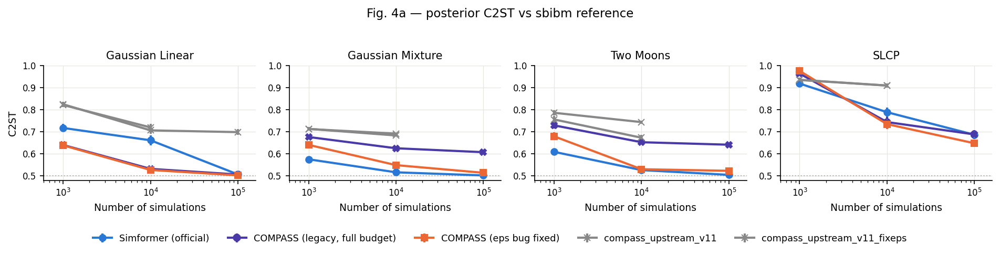

# Results — COMPASS vs Simformer (running log)

Metric: C2ST (random forest, 5 folds, their harness). 0.5 = indistinguishable
from the reference; lower is better. Δ = COMPASS − Simformer, paired over the
same observations. Tables are regenerated after every run in
`results/tables/`, figures in `results/figures/`.

## Improving COMPASS at 1k (round 1, 2026-10-01)

At ≥10k COMPASS already ties/beats Simformer, so the target is 1k. One change
per arm against COMPASS (eps fixed); full table `results/tables/fig4{a,b}_improve.md`.

| arm | what | effect at 1k |
|---|---|---|
| `compass_fx_euler500` | Simformer's sampler (Euler–Maruyama 500), same checkpoints | ≤ 0.014 either way: the sampler is not the gap |
| `compass_fx_final` | all data, final (averaged) weights, as Simformer | **Gaussian Linear 0.638 → 0.998**: the 12.9M-param model memorises the 1k simulations (loss on the seen subset 8.7 vs 25.4 held out). Tree/HMM +0.035. The best-val checkpoint is what keeps COMPASS usable at 1k. |
| `compass_fx_condemb` | + variable-ID and observed/latent token embeddings | Two Moons 4a −0.038, Gaussian Mixture −0.007; Tree +0.035, HMM +0.016 |
| `compass_fx_final_condemb` | both | as `final` (GL 0.999) |
| `compass_shared_t256/t64` | time conditioning shared across nodes (1.0M / 0.44M) | Tree −0.063, HMM −0.08/−0.11, GM −0.04/−0.06; Two Moons +0.08 (both figs) |

Reading: 1k is overfitting-limited (per-node adaLN = 95% of params), but Two
Moons needs *some* per-node time dependence. Round 2 tests a shared + rank-8
per-node modulation (`compass_fx_lowrank8`, 1.07M params at 4 variables) and
plain weight decay 0.1 (`compass_fx_wd`).

## Status 2026-09-30 15:40 (queue stopped for the jarvis/compgpu5 update)

Done: Fig. 4a and Fig. 4b complete for Simformer vs COMPASS (eps fixed); the
1k capacity test (shared time conditioning); upstream bGuenes/COMPASS
v1.1-integration at 1k and 10k; the step-time check. **Not done:** upstream
v1.1 at 100k (8 cells; the Gaussian Linear 100k job was killed mid-training,
nothing written). Resume with the last three lines of `queue_upstream.sh`
minus the Fig. 4b resume (already complete), i.e.

    ../../.COMPASS/bin/python -u run_benchmark.py fig4a --methods compass_upstream_v11 compass_upstream_v11_fixeps --resample-from compass_upstream_v11 --budgets 100000
    ../../.COMPASS/bin/python -u run_benchmark.py fig4b --methods compass_upstream_v11 compass_upstream_v11_fixeps --resample-from compass_upstream_v11 --budgets 100000

Backup: `~/backups/SimFormer_benchmark_2026-09-30_1538.tar.gz` (code +
results + checkpoints, without the envs and the two clones).

### Fig. 4b, complete (COMPASS with the eps fix)

Δ = COMPASS − Simformer, paired over 50 conditionals (negative = COMPASS better).

| task | 1k | 10k | 100k |
|---|---|---|---|
| Tree | +0.070 ± 0.012 | −0.009 ± 0.003 | +0.005 ± 0.002 |
| HMM | +0.164 ± 0.009 | +0.012 ± 0.003 | +0.011 ± 0.002 |
| Two Moons | +0.024 ± 0.007 | +0.013 ± 0.002 | +0.010 ± 0.002 |
| SLCP | +0.050 ± 0.010 | **−0.077 ± 0.016** | **−0.099 ± 0.018** |

Same picture as Fig. 4a: Simformer clearly better at 1k; from 10k on within
~0.01 on Tree/HMM/Two Moons and COMPASS clearly better on SLCP.

### Capacity test at 1k: time conditioning shared across nodes

`bridge/shared_time_transformer.py`: adaLN from time to 6·hidden (not
6·nodes·hidden) + a per-node ID bias; everything else unchanged. 1.0M params
(t256) / 0.44M (t64) instead of 2.8–12.9M. C2ST at 1k (lower is better):

| task | Simformer | COMPASS (fixed) | shared t256 | shared t64 |
|---|---|---|---|---|
| 4a Gaussian Linear | 0.717 | **0.638** | 0.682 | 0.667 |
| 4a Gaussian Mixture | **0.575** | 0.641 | 0.599 | 0.585 |
| 4a Two Moons | **0.609** | 0.679 | 0.758 | 0.762 |
| 4a SLCP | **0.919** | 0.977 | 0.955 | 0.962 |
| 4b Tree | **0.633** | 0.703 | 0.640 | 0.641 |
| 4b HMM | **0.643** | 0.807 | 0.722 | 0.701 |
| 4b Two Moons | **0.597** | 0.621 | 0.699 | 0.702 |
| 4b SLCP | **0.804** | 0.855 | 0.874 | 0.884 |

**Mixed — the parameter count is not the explanation.** Sharing helps 4/8
cells (Gaussian Mixture and Tree reach Simformer's level; HMM halves its gap;
SLCP 4a a little) but hurts 4/8, worst on both Two Moons cells (+0.08). t64 vs
t256 (0.44M vs 1.0M) changes nothing beyond noise, so size itself is not what
matters; *what* the per-node time modulation represents does (Two Moons needs
it, the others are hurt by it). Not pursued further.

### Upstream bGuenes/COMPASS v1.1-integration (926f580), as shipped

Package defaults (hidden 128, 16 heads, mlp 4, AdamWScheduleFree, Bernoulli
0.33 masks, mixture time sampling, DPM-2 50 + Langevin correctors); harness-
matched z-score and step budget. It has the same eps bug; `_fixeps` =
same checkpoint resampled with eps forwarded.

Parameters: 6.45M (4 variables), 17.7M (13), 26.5M (20); 78–94% in the
per-node adaLN. Simformer 0.18M; our arm 2.85–12.9M.

C2ST, upstream as shipped / upstream eps-fixed / our COMPASS (fixed) / Simformer:

| task | 1k | 10k |
|---|---|---|
| 4a Gaussian Linear | 0.825 / 0.822 / 0.638 / 0.717 | 0.706 / 0.720 / 0.527 / 0.661 |
| 4a Gaussian Mixture | 0.713 / 0.713 / 0.641 / 0.575 | 0.692 / 0.683 / 0.549 / 0.516 |
| 4a Two Moons | 0.786 / 0.756 / 0.679 / 0.609 | 0.744 / 0.673 / 0.530 / 0.526 |
| 4a SLCP | 0.935 / 0.936 / 0.977 / 0.919 | 0.910 / 0.910 / 0.735 / 0.789 |
| 4b Tree | 0.714 / 0.718 / 0.703 / 0.633 | 0.638 / 0.639 / 0.544 / 0.553 |
| 4b HMM | 0.844 / 0.850 / 0.807 / 0.643 | 0.746 / 0.753 / 0.573 / 0.561 |
| 4b Two Moons | 0.780 / 0.777 / 0.621 / 0.597 | 0.761 / 0.748 / 0.537 / 0.524 |
| 4b SLCP | 0.876 / 0.875 / 0.855 / 0.804 | 0.805 / 0.802 / 0.652 / 0.729 |

Upstream is the worst method in 15/16 cells (only SLCP 4a 1k beats our arm)
and, unlike our arm, barely improves from 1k to 10k; fixing eps helps it only
on Two Moons 10k — its error is in the trained network, not the sampler
blur. Which package default is responsible (mask law, time sampling,
optimizer, width) was not isolated.

Speed. Training s/step at batch 1000 (`diagnostics/out/step_time.txt`):
upstream 0.066 (4 var.) / 0.121 (20 var.) vs our arm 0.039 / 0.057 → 1.7–2.1×
slower; its stock data loader costs nothing extra here (0.0665 vs 0.0661 with
the bridge loader — the 7× loader slowdown we hit was specific to a per-row
*multinomial* mask law). Wall-clock training at 10k: upstream 1.5–4.0k s vs
Simformer 0.7–1.0k s (2–5.5×). Sampling (harness `time_eval`): upstream
4–43 s vs Simformer 4–26 s vs our arm 2–33 s — the Langevin correctors make
upstream ~2× Simformer.

## ⚠ Correction (2026-09-29): most of the gap was a COMPASS sampling bug

`ScoreBasedInferenceModel.sample()` accepts `eps` but never forwards it to
`Sampler.sample` (`src/compass/ScoreBasedInferenceModel.py:543`), so every
sample stops at the Sampler default eps = 1e-3 and is returned with
σ_z ≈ 0.032 of diffusion noise still on it (θ units: 0.018 Two Moons, 0.18
Gaussian Mixture) — wider than those posteriors' fine structure.

Evidence (`diagnostics/`):
* Adding exactly that noise to *exact* sbibm reference samples gives C2ST 0.633
  (Two Moons) and 0.601 (Gaussian Mixture) — COMPASS scored 0.641 / 0.607.
* The learned score is accurate: 0.2–3% relative error vs the exact diffused
  Two Moons posterior score at every noise level down to eps
  (`diagnostics/score_interaction.py`), and its latent–latent interaction
  matches the truth — the "latents can't attend latents" argument is refuted.
* Same checkpoint, eps actually forwarded (bridge workaround `forward_eps`,
  eps = 1e-5, DPM-2 100 steps): Two Moons 10k 0.653 → 0.530.

Earlier hypotheses in this file (noise floor during training, tokenizer) are
superseded; the "eps 1e-5" run in §1 only changed *training* eps because of
this bug.

### Fig. 4a, corrected (same checkpoints, resampled with eps forwarded)

C2ST, lower is better; Δ = COMPASS − Simformer paired over 10 observations.

| task | sims | Simformer | COMPASS (bug) | **COMPASS (fixed)** | Δ fixed |
|---|---|---|---|---|---|
| Gaussian Linear | 1k | 0.717 | 0.640 | **0.638** | −0.079 ± 0.017 |
| | 10k | 0.661 | 0.532 | **0.527** | −0.135 ± 0.022 |
| | 100k | 0.506 | 0.506 | **0.502** | −0.004 ± 0.001 |
| Gaussian Mixture | 1k | **0.575** | 0.676 | 0.641 | +0.065 ± 0.010 |
| | 10k | **0.516** | 0.625 | 0.549 | +0.033 ± 0.006 |
| | 100k | **0.502** | 0.607 | 0.514 | +0.012 ± 0.003 |
| Two Moons | 1k | **0.609** | 0.729 | 0.679 | +0.070 ± 0.009 |
| | 10k | 0.526 | 0.653 | 0.530 | +0.004 ± 0.003 (tie) |
| | 100k | **0.504** | 0.641 | 0.523 | +0.018 ± 0.003 |
| SLCP | 1k | **0.919** | 0.964 | 0.977 | +0.058 ± 0.008 |
| | 10k | 0.789 | 0.744 | **0.735** | −0.054 ± 0.033 |
| | 100k | 0.687 | 0.688 | **0.648** | −0.039 ± 0.024 |

Verdict: at ≥10k simulations COMPASS matches Simformer (Two Moons 10k), wins
Gaussian Linear and leans ahead on SLCP, and trails by 0.01–0.03 on the
Gaussian Mixture and Two Moons 100k. At **1k** Simformer is still clearly
better on the three non-Gaussian tasks (+0.06–0.07): a real small-data gap.

## 0. Pilot — Two Moons, 10k simulations (done 2026-09-28)

| method | C2ST | Δ vs Simformer | train |
|---|---|---|---|
| Simformer (official, dense, VESDE, Euler 500) | **0.525 ± 0.007** | — | 30k steps |
| COMPASS legacy trunk, DPM-2 50 (early-stopped at 9.6k steps) | 0.696 ± 0.009 | +0.171 ± 0.004 | 3.6 min |
| — same checkpoint, Euler–Maruyama 500 steps | 0.692 ± 0.009 | +0.167 ± 0.004 | — |
| — same checkpoint, DPM-2 200 steps | 0.693 ± 0.008 | +0.169 ± 0.003 | — |
| COMPASS legacy trunk, full 30k-step budget | 0.653 ± 0.005 | +0.128 ± 0.003 | 10.6 min |
| COMPASS tokenized trunk | 0.882 ± 0.005 | +0.358 ± 0.006 | — |

What the pilot established:

1. **The sampler is not the gap.** One checkpoint scored with three samplers
   (NFE 100 → 500) moves C2ST by < 0.005.
2. **Training length is part of it.** COMPASS's step-based early stopping (5k
   steps patience) stopped at 9.6k of 30k steps; training the whole budget, as
   Simformer does, gains 0.04. The grid therefore uses `compass_legacy_full`.
3. **The tokenized trunk fails on a correlated posterior**, as predicted by the
   known mean-field property (latent tokens never attend to latent tokens), so
   Two Moons' coupled (θ1, θ2) posterior cannot be represented. Dropped.
4. **A 0.13 gap remains** that is in the network. Leading suspect: the legacy
   tokenizer embeds a value as `value × learned vector` (no bias, no
   condition-state embedding — observed vs latent enters only through the
   attention key mask), whereas Simformer's token concatenates value, variable-ID
   and condition-state embeddings. Not tested yet.

Engineering found on the way (both fixed in the bridge, not in COMPASS):

* `compass.Trainer`'s dataset calls the mask sampler once per *row* and the
  DataLoader collates 1000 Python items per batch; with a batched on-GPU loader
  the step time fell from 0.16 s to 0.022 s (GPU 12% → 65%).
* The driver originally pinned every job to CPUs 0–2, which other jobs also
  used; jobs are now pinned to the 3 least-busy CPUs.

## 1. Fig. 4a — posterior benchmark (running)

Simformer vs COMPASS (legacy, full budget); 4 sbibm tasks × {1k, 10k, 100k}.
See `results/tables/fig4a.md` and `results/figures/fig4a.png`.

1k simulations (complete, 20:41):

| task | Simformer | COMPASS | Δ (paired, 10 obs) |
|---|---|---|---|
| Gaussian Linear | 0.717 ± 0.018 | **0.640 ± 0.010** | −0.077 ± 0.017 |
| Gaussian Mixture | **0.575 ± 0.012** | 0.676 ± 0.008 | +0.101 ± 0.009 |
| Two Moons | **0.609 ± 0.014** | 0.729 ± 0.015 | +0.120 ± 0.010 |
| SLCP | **0.919 ± 0.010** | 0.964 ± 0.006 | +0.045 ± 0.007 |

COMPASS wins only the linear-Gaussian task; the Two Moons gap (+0.12) is the
same as at 10k in the pilot (+0.13), i.e. systematic rather than small-data.

10k simulations (complete, 23:22):

| task | Simformer | COMPASS | Δ (paired, 10 obs) |
|---|---|---|---|
| Gaussian Linear | 0.661 ± 0.022 | **0.532 ± 0.004** | −0.130 ± 0.023 |
| Gaussian Mixture | **0.516 ± 0.004** | 0.625 ± 0.005 | +0.109 ± 0.005 |
| Two Moons | **0.526 ± 0.007** | 0.653 ± 0.005 | +0.127 ± 0.002 |
| SLCP | 0.789 ± 0.021 | 0.744 ± 0.024 | −0.045 ± 0.032 (n.s.) |

Two Moons 10k reproduces the pilot to three decimals (same seed, same data):
the harness is deterministic. Pattern: COMPASS is near-perfect on the
linear-Gaussian task (the one cell the paper also flags as Simformer's weak
one) and ties on SLCP, but is a constant ~0.11–0.13 behind on the two
strongly non-Gaussian 2-D posteriors (mixture with a 10× narrower component;
crescent-shaped Two Moons).

100k simulations (complete, 06:21 on 09-29):

| task | Simformer | COMPASS | Δ (paired, 10 obs) |
|---|---|---|---|
| Gaussian Linear | 0.506 ± 0.001 | 0.506 ± 0.001 | −0.000 ± 0.001 (tie) |
| Gaussian Mixture | **0.502 ± 0.002** | 0.607 ± 0.003 | +0.105 ± 0.003 |
| Two Moons | **0.504 ± 0.003** | 0.641 ± 0.004 | +0.137 ± 0.002 |
| SLCP | 0.687 ± 0.013 | 0.688 ± 0.021 | +0.002 ± 0.025 (tie) |

**Fig. 4a verdict (12 cells):** COMPASS wins 2 (Gaussian Linear 1k, 10k),
ties 4 (Gaussian Linear 100k, SLCP 10k/100k — and SLCP 10k leans COMPASS),
loses 6 (all of Gaussian Mixture and Two Moons, plus SLCP 1k).
The Gaussian Mixture gap is +0.101 / +0.109 / +0.105 and the Two Moons gap
+0.120 / +0.127 / +0.137 at 1k / 10k / 100k: **flat in the budget**, so it is
a representational floor, not a data or training-length effect.

### Hypothesis under test: COMPASS's noise floor is coarser than the posterior

COMPASS trains and samples down to `eps = 1e-3` (hard-coded in
`Trainer.train`), i.e. σ_min ≈ 0.032 in z-scored units under its VESDE(σ=25).
The failing posteriors have structure narrower than that: the GM narrow
component (std 0.1 in θ ∈ U(−10, 10)) is ≈ 0.017 after z-scoring; the Two Moons
crescent (radial std 0.01) is ≈ 0.017. Simformer goes down to σ_min = 1e-4. The
tasks COMPASS ties or wins (Gaussian Linear, SLCP) have no sub-0.03 structure.
Test: `compass_legacy_full_eps5` (train and sample to eps = 1e-5,
σ_min ≈ 0.003; 100 DPM-2 steps) on Two Moons and Gaussian Mixture at 10k.

| task (10k) | Simformer | COMPASS eps 1e-3 | COMPASS eps 1e-5 |
|---|---|---|---|
| Gaussian Mixture | 0.516 ± 0.004 | 0.625 ± 0.005 | 0.606 ± 0.005 |
| Two Moons | 0.526 ± 0.007 | 0.653 ± 0.005 | 0.644 ± 0.007 |

**Mostly refuted.** A 10× finer noise floor recovers 0.019 (GM) and 0.009
(TM) of gaps of 0.109 and 0.127. The floor is a minor contributor; the main
cause lies elsewhere. Remaining untested suspect: the legacy tokenizer
(`value × learned vector`; no condition-state or variable-ID embedding, so
observed vs latent is visible only through the attention key mask).

## 2. Fig. 4b — all conditionals (running)

50 conditionals per cell drawn by their `structured_random` law (joint,
posterior, likelihood, Bernoulli 0.3 / 0.7 masks), 2000 samples each, MCMC
reference from their `reference_sampler`; identical conditionals for both
methods (eval RNG is independent of the method).

1k simulations (complete, 08:18):

| task | Simformer | COMPASS | Δ (paired, 50 conditionals) |
|---|---|---|---|
| Tree | **0.633 ± 0.008** | 0.681 ± 0.014 | +0.048 ± 0.010 |
| HMM (Markov chain) | **0.643 ± 0.013** | 0.796 ± 0.012 | +0.153 ± 0.008 |
| Two Moons | **0.597 ± 0.010** | 0.643 ± 0.011 | +0.046 ± 0.007 |
| SLCP | **0.804 ± 0.021** | 0.849 ± 0.016 | +0.045 ± 0.010 |

## Smallest version across budgets (2026-10-02)

No-time-modulation arms (`bridge/notime_transformer.py`): plain pre-LN blocks, no adaLN.
At 1k the three small arms (time at input 0.37M, time added per block 0.45M,
shared-time t64 0.44M) and the full model are tied on mean Δ Sim (+0.050/+0.057/+0.051
vs +0.053); "no time input at all" (0.25M) is clearly worst (+0.096). At 10k the
three small arms are within ~0.01 of each other, so only `compass_fx_notime_add`
was run at 100k.

Mean C2ST gap to Simformer over the 8 tasks (lower is better):

| budget | COMPASS (eps fixed, 2.8–12.9M) | no time mod., time/block (0.45–0.48M) |
|---|---|---|
| 1k | +0.053 | +0.050 |
| 10k | −0.027 | +0.009 |
| 100k | −0.011 | +0.020 |

The small model's 1k edge is the large one overfitting; from 10k on, capacity in
the per-node time modulation pays off, most on SLCP (100k: 0.807 vs 0.648) and the
Two Moons tasks. Excluding SLCP the small arm is within ~0.01 of the large one at 100k.
Tables: `results/tables/fig4{a,b}_improve.md`.

## Architecture / mask tests (2026-10-04 – 10-06)

All vs `compass_legacy_full_fixeps` (Simformer mask law), C2ST, tables in
`results/tables/fig4{a,b}_improve.md`. Bridge-only code; remove by deleting the
named file, its configs and its `cfg.get(...)` block in `bridge/compass_worker.py`.

- `compass_fx_mask6mix` (`mask_law: six_mixed`): the six conditionals collapse on a
  flat task to 37.5% posterior / 37.5% likelihood / 25% Bernoulli(0.33), no joint.
  Worse than the Simformer law on most cells (HMM 10k +0.092, SLCP 10k +0.067;
  Fig 4b all budgets); the exception is SLCP 4a 100k (0.604 vs 0.648).
- `compass_fx_fullattn` (`bridge/fullattn_transformer.py`): drop the `1 - c`
  key mask (latents attend latents) + condition-state embedding. Worse at 1k
  (overfitting) and 10k (SLCP +0.062, HMM +0.055); ~neutral at 100k except SLCP
  (all cond.) 0.576 (best) and SLCP 4a 0.619. Diagnostic: without input scaling
  latent queries put 40–53% of attention on other latents, rising with sigma.
- `compass_fx_inscale` (`bridge/input_scaling.py`, latent inputs x 1/sqrt(1+sigma^2)):
  removes that rise (flat ~0.42) but is ~neutral on C2ST at every budget
  (100k: within ±0.007 except SLCP −0.007). With full attention: SLCP 100k 0.588
  (−0.060), other cells within ~±0.015.
- Conclusion: no architecture change closes the 0.01–0.02 gap on GM / Two Moons /
  HMM at 10k–100k. Next: Simformer's optimizer (Adam, linear decay to 1e-6 over
  the second half, AGC 10, final weights) and uniform time sampling
  (`bridge/simformer_optim.py`, `compass_fx_simopt{,_unif}`), running.
