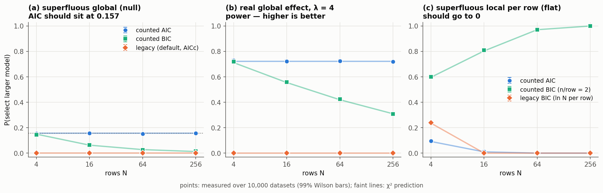

# A1 — parameter counting in AIC / AICc / BIC

Status: **done.**

- Validated at level (a), closed-form likelihoods (below).
- Validated at level (b), the real `compare()` pipeline with oracle networks, in
  `../a2_maximum_likelihood` (E-A1.5): the counted AIC overfit rate through the
  pipeline is 0.155 against a prediction of 0.157.

## What was wrong

`ModelTransfuser.compare` computed the criterion per observation row, with `k` = the
full latent dimension, and summed over rows. With N rows:

| | legacy total penalty | what it should be |
|---|---|---|
| AIC | `2 N k` — a global is charged N times | `2 (k_global + N k_local)` |
| AICc | per row with `n = N`, falls back to AIC *per model* | `n_data = N · n_per_observation`, the fallback decided jointly |
| BIC | `N k ln N` | `k_global ln n_data + N k_local ln n_per_observation` |

## What changed

- `src/compass/information_criteria.py`:
  - `information_criterion` and `compare_criteria`;
  - per-row terms that sum exactly to the total;
  - the joint AICc fallback;
  - the BIC consistency warning.
- `ModelTransfuser.compare(..., ic_convention="counted" | "legacy", n_per_observation=None,
  criterion="aic" | "aicc" | "aic_plain" | "bic")`:
  - `"aic"` still means AICc, for backward compatibility;
  - globals are the `hierarchy` dims under `multi_obs_inference`;
  - the cumulative plot uses the same counting.
- `tests/test_variable_param_count.py::test_bic_criterion` asserted the old behaviour
  (BIC > AIC for per-row parameters at n > 8). It now asserts the exact counted
  penalties, and that `ic_convention="legacy"` still reproduces the old numbers.

## Experiment (E-A1.2 – E-A1.4) — `known_answer.py`

Exact likelihoods, exact MLE/MAP, library criterion code. 10,000 datasets per cell,
N ∈ {4, 16, 64, 256}, predictions from χ² theory written down before the run. Full
tables: `results/known_answer.md` (seed 20261013) and `results/known_answer_seed7.md`.

**Calibration.** 93/96 and 96/96 cells lie inside the 99% Wilson interval of the
prediction. The three misses on the first seed are a single draw (flat, N = 16)
counted under three labels that coincide there, sitting at the interval edge. On the
second seed the same cells pass.

Key rows (seed 20261013):

| setting | N | counted AIC | legacy (AICc as before) | prediction (counted) |
|---|---|---|---|---|
| superfluous global, null | 4 | 0.154 | 0.000 | 0.157 |
| | 16 | 0.156 | 0.000 | 0.157 |
| | 256 | 0.158 | 0.000 | 0.157 |
| real global effect, λ = N δ² = 4 (power) | 4 | 0.730 | 0.000 | 0.721 |
| | 16 | 0.723 | 0.000 | 0.721 |
| | 256 | 0.719 | 0.000 | 0.721 |
| MAP plug-in (shrink c = ½), null | 16 | 0.104 | 0.000 | 0.103 |

*Points: measured selection rate of the larger model over 10,000 datasets, with 99%
Wilson bars (mostly smaller than the markers). Faint lines: χ² prediction.*

- (a) Counted AIC sits on 0.157 for every N, while legacy never selects.
- (b) With a real global effect, counted AIC keeps its power; legacy has none.
- (c) Superfluous per-row parameters: counted BIC with 2 scalars per row diverges
  toward 1, as predicted.

Regenerate with `python -m validation.a1_information_criteria.plots`.

### What this shows

1. **The legacy convention could not detect a real global effect.** Power is 0.000
   from N = 16 on, where a correct AIC has 0.72. Any past comparison between models
   that differ in a *global* parameter was decided by the penalty, not the data.
2. **Counted AIC behaves as textbook AIC.** The overfit rate is 15.7% and independent
   of N, and the power matches the noncentral χ² prediction.
3. **The MAP plug-in biases selection** exactly as predicted: the χ² statistic is
   multiplied by 1 − (1 − c)². This is A2's motivation, confirmed at level (a).
4. **New bug, now fixed: AICc fallback per model.**
   - When AICc was undefined for one model (n_data ≤ K + 1), that model alone fell back
     to AIC and was then compared with the other model's AICc.
   - In the flat case that picked the larger model in **100%** of datasets.
   - The fallback is now joint (`compare_criteria`); seed-7 rows show the fixed
     behaviour.
5. **AICc is very conservative for hierarchical models with locals.** K grows like N
   while n_data = N · n_per_observation, so the correction is large.
   - Power at N = 4 is 1% for AICc vs 73% for AIC; at N = 256 it is 20% vs 72%.
   - **Recommendation:** use `criterion="aic_plain"` (or the evidence, A4) for
     hierarchical comparisons. The default `"aic"` = AICc is kept for compatibility.
6. **BIC with local parameters is not consistent when ln(n_per_observation) ≤ 1.**
   - In the flat case with two scalars per row, BIC picks the superfluous model with
     probability → 1 as N grows (0.60, 0.81, 0.97, 1.00).
   - This is a property of BIC, not of the code: a superfluous local parameter gains
     χ²₁ (mean 1) per row and pays ln 2 = 0.69.
   - The legacy BIC "passed" this case (rate → 0) only because it used ln N for
     per-row parameters, which is wrong.
   - `compare()` now prints a warning in this regime.

### Critical notes

- A "rate matches prediction" result at level (a) validates the counting and the
  criterion code. It does not validate the pipeline; that is E-A1.5/E-A2.3.
- The predictions assume a regular model (an unbounded location parameter). Variance
  parameters near 0 would need the ½χ²₀ + ½χ²₁ mixture.
- Counting locals as free parameters is the *conditional* AIC. For hierarchical
  models it is one defensible choice, not the only one; the marginal AIC
  (`K = k_global`, locals integrated out) is A4.
- BIC's `n` in a hierarchy is a convention. The test checks consistency (rate → 0 for
  globals, 0.149 → 0.013), not a unique constant.
