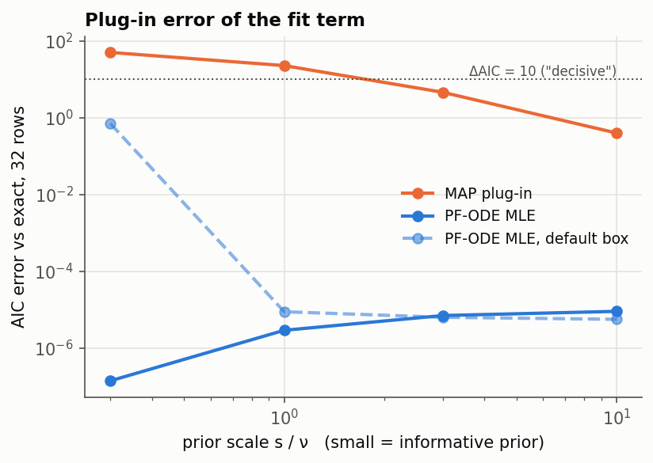
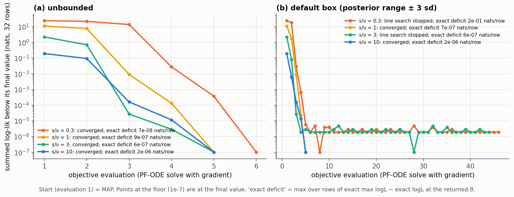
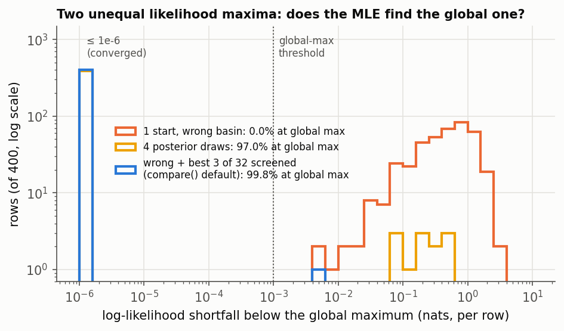
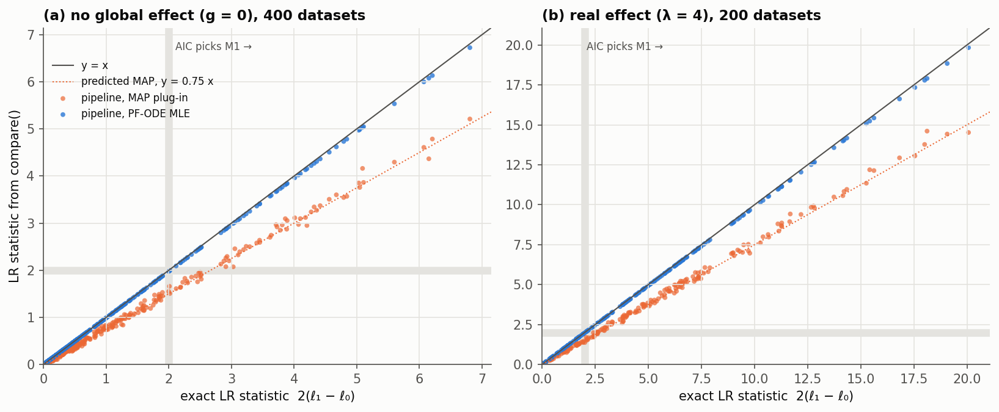

# A2 — plug in the maximum-likelihood estimate, not the MAP

Status: **implemented and validated with exact-score oracles** (levels a and b).
The trained-network check ("does the optimiser exploit network error?") is still
open and belongs with B6/C9.

## What was wrong

AIC, AICc and BIC are defined at the *maximum* of the likelihood. `compare()` plugged
in the posterior MAP, which is pulled toward the prior, so `log p(x | θ_MAP)`
under-estimates the fit term. The bias is largest for models with informative priors.
Under `multi_obs_inference` the globals were also held at the posterior *mean*.

## What changed

- `PFODE.log_prob(..., differentiable=True)`, also on `SBIm.log_prob`: the same Heun
  integrator, with `create_graph` through the exact (or Hutchinson) divergence.
  `∂ log p(x | θ) / ∂θ` is then the exact gradient of the discretised density that the
  criterion uses.
- `src/compass/likelihood_maximization.py` — `maximize_likelihood`:
  - L-BFGS-B in posterior-standardised coordinates, with box constraints;
  - shared (global) dims are one value for all rows;
  - multi-start, with optional screening of many starts (`keep_best_starts`);
  - the best value seen is kept, so it never ends below its start;
  - it reports which coordinates sit on the box.
- `ModelTransfuser.compare(point_estimate="mle")` is the new default (`"map"` is the
  legacy behaviour).
  - Starts: the `map_method` point estimate, plus the best `mle_starts − 1` of
    `mle_screen` posterior draws.
  - Box: `theta_bounds`, or the posterior range ± `mle_box_width` sds.
  - The optimisation runs on a coarse `mle_timesteps` grid; the final value is taken on
    `log_prob_timesteps`. Per row (or for the total, with globals) the larger of the
    MAP and MLE values is kept.
  - New `stats` keys: `MLE`, `log_probs_at_map`, `mle_info` (box hits, starts,
    evaluations).
  - A message is printed if any row's MLE sits on the box.

## E-A2.1 / E-A2.2 — exactness and the size of the MAP bias (`exactness.py`)

Oracle network for θ ~ N(0, s² I₂), x = B θ + ν ε (x ∈ R³), 32 rows; the MLE is
closed-form. Full table: `results/exactness.md`.

| s/ν | MLE − MAP (posterior sds) | MAP plug-in AIC error | PF-MLE max location error (sds) | PF-MLE max deficit (nats/row) | PF-MLE AIC error |
|---|---|---|---|---|---|
| 0.3 | 1.96 | 49.7 | 9e-4 | 7e-8 | 1e-7 |
| 1 | 0.62 | 22.6 | 2e-3 | 9e-7 | 3e-6 |
| 3 | 0.23 | 4.6 | 1e-3 | 6e-7 | 7e-6 |
| 10 | 0.07 | 0.4 | 1e-3 | 2e-6 | 9e-6 |

- **Prediction met:** the MLE deficit stays at the solver floor for every prior scale.
  It converges in about 5 objective evaluations (~1 s for 32 rows).
- **Convergence**, shown in `results/figures/fig_mle_convergence.png` (traces in
  `results/exactness.json`, `trace_total_loglik`, and scipy messages in `messages`):
  - Unbounded, every prior scale reaches L-BFGS-B's `CONVERGENCE: NORM OF PROJECTED
    GRADIENT <= PGTOL` in 5–6 evaluations. The objective falls from 0.2–25 nats below
    its optimum to the 1e-7 floor.
  - With the box, two runs end in `ABNORMAL` (line search stopped). They reach the
    float32 noise floor of the objective (~2e-6 nats) by evaluation 5 and then wander
    on it, which costs evaluations but not accuracy, because the best value is kept.
  - The 0.2 nats/row deficit at s/ν = 0.3 is the box binding, not non-convergence.

  

- **The MAP bias is large.** Even with s = ν it is 22.6 AIC units on 32 rows, more than
  the "decisive" threshold of ~10 on its own.
- **Box (default: posterior range ± 3 sds).**
  - At s/ν = 0.3 the MLE lies ~2 posterior sds beyond the MAP, and the box binds on
    3/32 rows. The residual AIC error is 0.7, versus 49.7 for the MAP.
  - This is reported, not hidden. Pass `theta_bounds` (the prior support) when the
    prior is that informative.
- **PF-ODE offset** at the optimum: +0.004 ± 0.004 nats/row against the exact
  likelihood. This is the solver plus σ(eps) smoothing. It is the same for every row
  and model of equal x-dimension and cancels in ΔIC, but it is a B5/B6 item.

## Multi-start on a non-concave likelihood (`nonconcave.py`)

x₁ = θ² + noise, x₂ = 0.3 θ + noise: two maxima near ±√x₁ of unequal height. The
global maximum comes from a dense grid. 400 rows.

| starts | global max found | mean / max shortfall (nats) |
|---|---|---|
| 1 start in the wrong basin | 0% | 0.63 / 2.75 |
| 4 posterior draws | 97% | 0.008 / 0.59 |
| wrong basin + best 3 of 32 screened draws (**`compare()` default now**) | 99.75% | 1e-5 / 0.005 |

- L-BFGS-B is a local method. Plain posterior-draw multi-start misses when every draw
  lands on the other branch: (1 − 0.62)⁴ ≈ 2%, measured 3%.
- Screening many draws with one gradient-free PF-ODE evaluation is cheap and closes the
  gap. The one remaining "miss" is a row converged to 0.005 nats, i.e. tolerance.

## E-A1.5 / E-A2.3 — the real pipeline (`pipeline_selection.py`, `analyze_pipeline.py`)

The real `ModelTransfuser.compare` with exact-score oracle networks:

- composed posterior sampling (`gauss_hierarchical`) for M1;
- score-ascent MAP, PF-ODE likelihood, PF-ODE MLE, and the counted criteria.

Nested pair `x = (l + ν e, g + ν e)` vs `g = 0`, N = 16 rows. The prior on g is
`s_g = ν/√N`, so the MAP shrinks g by c = ½ (predicted LR factor 0.75). For every
dataset, the exact closed-form decision is computed too, so the pipeline is graded
**per dataset**, not only through its rate. Summary: `results/pipeline_summary.md`.

*Each point is one dataset. Blue: `compare()` with the MLE plug-in, on y = x. Orange:
the MAP plug-in, on the predicted y = 0.75 x line. The grey bands mark the AIC
decision boundary LR = 2. MAP points left of the vertical band and below the
horizontal band are datasets where the MAP flips the decision.*

| | null, 400 datasets: rate M1 (pred.) | agreement with exact | effect λ = 4, 200 datasets: rate (pred.) | agreement |
|---|---|---|---|---|
| AIC, exact | 0.160 (0.157) | — | 0.740 (0.721) | — |
| AIC, **PF-ODE MLE** | **0.155** (0.157) | **99.5%** | **0.735** (0.721) | **99.5%** |
| AIC, MAP | 0.117 (0.102) | 95.8% | 0.670 (0.643) | 93.0% |
| BIC, MLE | 0.077 (0.063) | 100% | 0.590 (0.555) | 100% |
| BIC, MAP | 0.033 (0.032) | 95.5% | 0.490 (0.441) | 90.0% |

All rates are inside their 99% Wilson intervals.

- **Likelihood-ratio error of the MLE path:** mean −0.012 (sd 0.016) under the null and
  −0.064 (sd 0.052) with the effect. The 2 disagreeing datasets out of 400 sit at
  LR ≈ 2, within that error of the boundary.
- **MAP path:** the LR is shrunk by a median 0.761 (predicted 0.75).
- **The g MLE** matches the exact `mean(x2)` to 2e-4 (0.001 posterior sd). No dataset
  touched the box, and no row fell back to the MAP.
- **Signal for B7.** The PF-ODE log-likelihood is over-estimated by ~0.26–0.29
  nats/dataset (≈ 0.017 nats/row). It is slightly larger for M0 under the effect,
  whose rows have large residuals. That is why the LR error grows with the effect: the
  density in the *tails* is less accurate. Small here, but it is the mechanism B7
  should measure on trained networks.

## Critical notes / open

- Everything above uses exact scores. On a trained network, maximising the learned
  density rewards places where the network *over*-estimates the density. This must be
  checked before `point_estimate="mle"` is trusted there:
  - Compare the PF-ODE value at the MLE with the true likelihood (for simulators with
    a tractable likelihood).
  - Check whether that gap grows with the number of optimiser steps.
  
  Planned in B6/C9.
- The conditional MLE of a hierarchical model frees every local. For models with as
  many locals as scalars per row, the conditional likelihood is degenerate. That is a
  limit of conditional AIC; the marginal version is A4.
- Cost: about 40 s per dataset for both models together at N = 16 on 3 CPU threads with
  the oracle, dominated by composed posterior sampling. The MAP/MLE split (E-A2.4) has
  not been measured separately yet.
