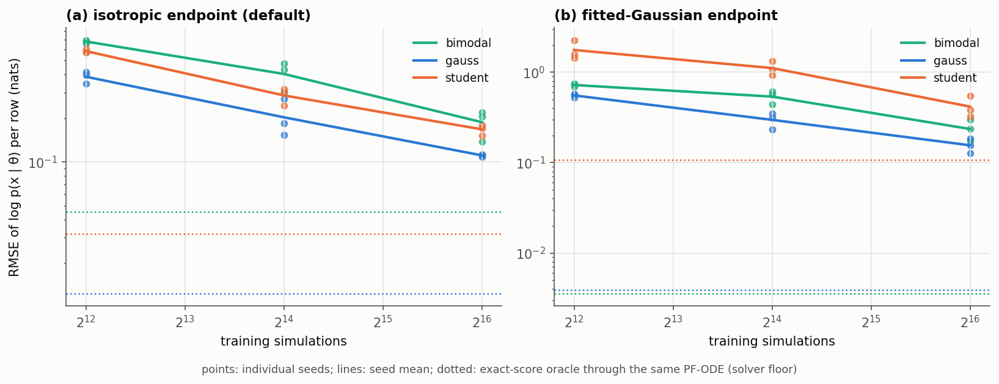
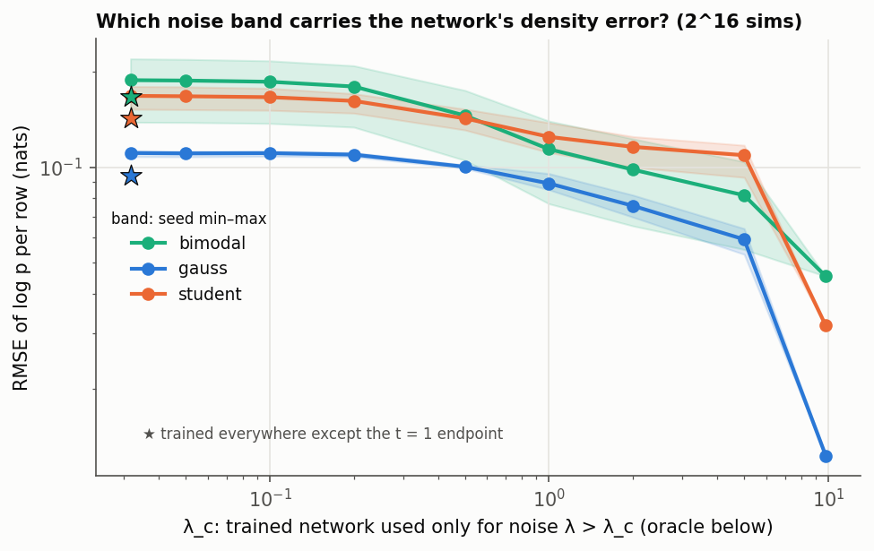
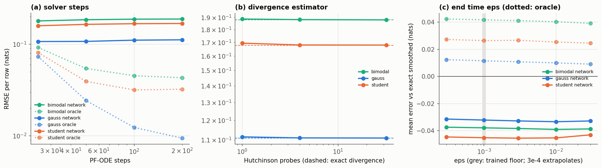
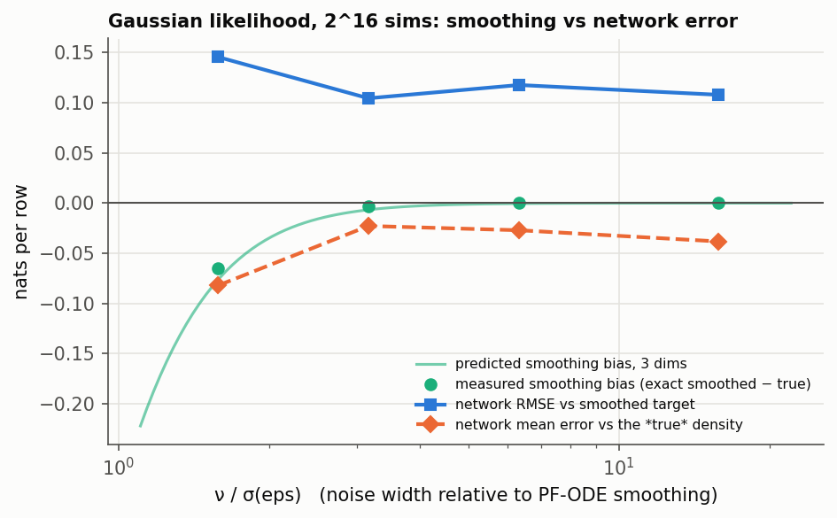
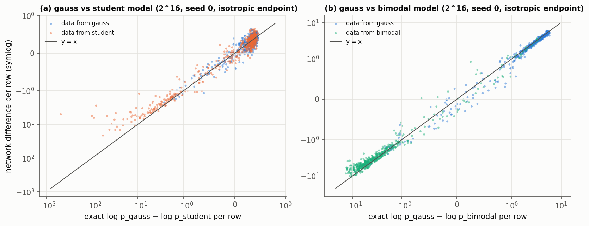

# B5 / B6 — accuracy of the PF-ODE likelihood with trained networks

Status: **done** (2026-10-14): 30 networks, 33 evaluations; all predictions checked below.

## Question

Every criterion (A1–A4) is built from `log p(x | θ)` evaluated with the PF-ODE through
a trained score network. How wrong is that number, where does the error come from,
and does it cancel between candidate models?

## Design

- **Families** (`families.py`): θ ~ N(0, I₂), x = Bθ + noise ∈ R³, with Gaussian,
  Student-t (df 3) and two-peaked mixture noise, ν = 0.5. Given θ, the observed dims
  are independent, so the exact likelihood and its σ(eps)-smoothed version are
  closed form or 1-D quadrature.
- **Exact-score oracle for the likelihood direction** (`LikelihoodOracle`): the diffused
  score of p(x | θ) per dim (closed form, or quadrature for Student-t).
  - Through the same PF-ODE it gives the **solver floor**.
  - `HybridNetwork` uses the trained network only for λ_c < λ < λ_hi and the oracle
    elsewhere, which **attributes the network's error to noise bands**. The endpoint
    can be swapped in on its own.
- **Networks** (`train.py`): legacy COMPASS transformer (hidden 128, depth 4, 8 heads,
  5.3 M parameters), VESDE σ = 25, `log_sigma` time sampling, Bernoulli mask menu.
  - Budgets 2¹², 2¹⁴, 2¹⁶ simulations × 3 seeds × 3 families. A seed controls data
    *and* initialisation.
  - Plus a noise sweep ν ∈ {0.05, 0.1, 0.2} at 2¹⁶.
  - The final-epoch model is evaluated.
- **Evaluation** (`evaluate.py`): 512 test points per family at the true θ.
  - Settings: steps {25, 50, 100, 200}; Hutchinson {1, 4, 32}; endpoint
    {fitted Gaussian, isotropic, oracle}; eps {3e-4, …, 3e-2}; hybrid λ_c grid.
  - Cross-family log p for model differences.
  - MLE runs for the A2 "too good MLE" check.

## Predictions (written before the trained-network results)

1. **Budget.** The error falls with simulations. Even at 2¹⁶ it stays at least 10×
   above the oracle floor (~0.003 nats/row). *Falsified if* any family reaches the
   floor.
2. **Bands.** Revised after the first 2¹² network: the error is carried by the *highest*
   noise band and the endpoint (λ ≳ 5), not by the low-λ band. This contradicts the
   original B5 hypothesis. *Check at 2¹⁶:* if more data fixes the top band, the
   low-λ band may take over.
3. **Endpoint.** With trained networks the fitted-Gaussian endpoint can be *worse*
   than the isotropic one, because it relies on the network Jacobian (memory: network
   Jacobians are not Hessians). The first 2¹² network gives RMSE 0.52 vs 0.40. Which
   endpoint should be the default is decided here.
4. **Solver factors.** Steps beyond 100 and Hutchinson probes are negligible next to
   the network error. (The 2¹² network: ±0.01 across all of them.)
5. **eps.** Larger eps lowers the error only slightly; 3e-4 (below the trained floor)
   is no worse than 1e-3 for these ν = 0.5 likelihoods. The noise sweep shows the
   smoothing bias growing as ν approaches σ(eps) = 0.032.
6. **Model differences (B6.3).** The per-row error of log p_gauss − log p_student is
   smaller than the per-model error (partial cancellation), but not negligible next to
   the exact per-row difference. Sign agreement of N = 16 sums: > 90% at 2¹⁶.
7. **Too-good MLE.** At the PF-ODE MLE the network value *exceeds* the exact likelihood
   there (optimiser exploits over-estimation), increasingly with iterations.

## Results

All numbers are from `results/summary.md`; figures are in `results/figures/`. The
reference setting is 100 steps, exact divergence, eps 1e-3 and the isotropic endpoint
(the default). Error = PF-ODE log p(x | θ) − exact σ(eps)-smoothed log p, per row
(3 observed dims), on 512 test rows; seed mean ± sd over 3 seeds.

### 1. Error vs simulation budget: prediction 1 held

| family | 2¹² | 2¹⁴ | 2¹⁶ | bias at 2¹⁶ | exact-score floor |
|---|---|---|---|---|---|
| Gaussian | 0.387 ± 0.030 | 0.203 ± 0.050 | 0.111 ± 0.002 | −0.032 | 0.012 |
| Student-t | 0.582 ± 0.015 | 0.288 ± 0.031 | 0.168 ± 0.011 | −0.045 | 0.032 |
| bimodal | 0.678 ± 0.013 | 0.404 ± 0.074 | 0.188 ± 0.035 | −0.038 | 0.045 |

- The error falls roughly as N^−0.45 and is still 4–9× the solver floor at 2¹⁶.
- Trained networks are biased **low** (they under-estimate the density by 0.03–0.05
  nats/row), while the exact-score PF-ODE is biased slightly high.
- Over N rows, an error of 0.11–0.19 nats/row means log-likelihood totals are uncertain
  at the level of a few nats for N ≈ 16–100, unless the errors cancel between models
  (§5).

### 2. Which noise band carries the error: the original B5 hypothesis is falsified

- Using the trained network only above λ_c, and the exact oracle below it: the curve is
  **flat for λ_c < 0.2**. The low-noise band, where the score is known to shrink toward
  the conditional mean, contributes nothing measurable to the density error.
- The error builds up across the middle bands (0.2 < λ < 5). The largest single step is
  the top band (λ > 5, up to λ_max = 9.8), where a small relative error in the score
  turns into a density error.
- Swapping in the exact endpoint alone (★) removes only ~15% (Gaussian 0.111 → 0.094).
  So it is the high-noise *integration*, not the endpoint formula.
- **Practical consequence:** improving the likelihood means training more weight at
  *high* noise. That is the opposite of the low-λ focus of `log_sigma` time sampling,
  which was chosen for posterior quality. This is a C10/C11 question (time-sampling and
  mask menu for the likelihood direction).

### 3. Endpoint: prediction 3 held, so the default reverted

- With exact scores, the fitted-Gaussian endpoint removes the model-dependent endpoint
  bias (+0.039 → +0.0005 nats on the bimodal family).
- With trained networks it is **worse in every family and budget**: 2¹⁶ RMSE 0.156 /
  0.417 / 0.236 vs 0.111 / 0.168 / 0.188 isotropic. On rows where the network Jacobian
  is near flat it explodes (single rows off by 10–8000 nats).
- **`endpoint="isotropic"` is the default again.** `"gaussian"` stays available for
  exact or near-exact scores.

### 4. Solver factors: prediction 4 held

- **Steps:**
  - With exact scores, more steps help (25 steps: 0.07; 100: 0.012; 200: 0.009).
  - With trained networks, 25 steps are as good as 200 (Gaussian 0.107 vs 0.112).
  - The network error dominates, so **25–50 steps suffice**: a 2–4× cheaper
    likelihood.
- **Divergence:** Hutchinson with **1 probe** matches the exact divergence to within
  0.002 nats/row, so the expensive exact divergence buys nothing with trained networks.
- **eps (prediction 5 held):**
  - The error is flat from 3e-4 (below the trained floor) to 3e-2. Going below the
    trained eps does not hurt for these likelihoods.
  - The noise sweep shows the σ(eps) smoothing bias exactly on its prediction:
    −0.065 nats/row at ν/σ(eps) = 1.6, and negligible above ν/σ ≈ 3.

### 5. Model differences (E-B6.3): prediction 6 partly held (no cancellation), plus a systematic bias toward the wrong model

Per-row difference log p_A − log p_B from two separately trained networks, against the
exact difference, on identical rows. Isotropic endpoint, 2¹⁶ simulations:

| pair, data | exact Δ sd/row | Δ error mean | Δ error sd | 16-row decision agrees with exact |
|---|---|---|---|---|
| gauss vs student, gauss data | 0.38 | −0.003 | 0.125 | 94.8% |
| gauss vs student, student data | 22.8 | **+2.24** | 22.2 | 97.9% |
| gauss vs bimodal, gauss data | 1.90 | −0.17 | 0.27 | 100% |
| gauss vs bimodal, bimodal data | 3.29 | **+0.78** | 1.52 | 100% |

- **Little cancellation.** On Gaussian data the error of the difference (sd 0.125) is
  as large as each model's own error (0.11 and 0.17). The two networks' errors are
  essentially independent.
- **The misspecified model's network is too generous.** When the data come from the
  other family, the wrong model's network over-estimates the likelihood by +0.78
  (bimodal data) to +2.24 (Student-t data) nats/row. This barely improves with budget
  (+2.63 → +2.36 → +2.24).
  - The panel (a) outliers show the mechanism. An observation 100 noise widths out has
    an exact Gaussian log-density of −480, but the Gaussian network reports about −10
    to −50. It never saw anything that far out, and it cannot express "impossible".
  - This is the out-of-distribution failure that B7 was written for. It biases every
    comparison *toward the wrong model*.
- **Decisions still mostly agree** (95–100% of 16-row comparisons at 2¹⁶) because the
  true differences here are large. The 5% disagreements on Gaussian data are datasets
  near a tie, where the network noise of ~0.125·√16 = 0.5 nats per comparison decides.
  At 2¹² that falls to 90–93%.

### 6. Tails (B7 preview)

The 5% least likely test rows carry 3–4× the error of the more likely half:

| family | RMSE, least likely 5% | RMSE, likely 50% |
|---|---|---|
| Gaussian | 0.27 | 0.07 |
| Student-t | 0.47 | 0.11 |
| bimodal | 0.36 | 0.13 |

Since −2 log p is dominated by unlikely rows, the criterion's error is dominated by the
network's least accurate rows.

### 7. "Too-good MLE" (A2 open item): prediction 7 held, shrinks with budget

Maximising the network likelihood from the true θ (Gaussian family). The table gives
network value − exact value at the returned θ:

| simulations | 5 iters | 20 iters | 100 iters |
|---|---|---|---|
| 2¹² | +0.013 | +0.162 | +0.218 |
| 2¹⁴ | +0.026 | +0.066 | +0.076 |
| 2¹⁶ | +0.012 | +0.026 | +0.028 |

- The optimiser finds places where the network over-states the density, more so with
  more iterations and fewer simulations. At 2¹⁶ the effect is +0.03 nats/row,
  comparable to the network's own bias, and the returned θ is within 0.012 nats of the
  exact maximum.
- Student-t and bimodal at 2¹⁶ and 100 iterations: +0.057 and −0.024.
- **For small budgets, cap the MLE iterations (~5–20)** or accept a +0.1–0.2 nats/row
  optimistic fit.

## Bottom line for model comparison

- Under the default settings, a trained network's per-row log-likelihood error at 2¹⁶
  simulations is ~0.1–0.2 nats. It is biased low, does not cancel between models, and
  is concentrated in unlikely rows. It errs systematically in favour of a misspecified
  model when the data fall outside that model's training range.
- Decisions with true per-row differences ≳ 0.5 nats are reliable. Near-ties are
  decided by network noise.
- Next items in order:
  - **C9** (seed spread of ΔIC; swap test);
  - **B7** (OOD flag: the misspecified-model bias needs to be detected, not just
    measured);
  - **C10/C11** (more training weight at high noise for the likelihood direction).

## Process notes (what went wrong while running this)

- **Student-t χ² draws used the global RNG**, so test sets differed between processes.
  The first gauss-vs-student comparison ("78% agreement") paired different rows and was
  withdrawn. Fixed (χ²₃ as squared normals from the seeded generator). The analysis now
  refuses to grade differences unless the rows are bit-identical.
- **The Student-t reference quadrature** was wrong for an outlier at |r| = 134ν. It now
  uses Gauss–Hermite for narrow kernels (agrees with brute force to 1e-9).
- **The first full evaluation ran with the fitted endpoint as default** and is kept in
  `results/raw_fitted_endpoint/` for the endpoint comparison only.
- **Three GPU workers once picked the same free GPU** (autocvd race) and ran out of
  memory. Workers now start 2 minutes apart.
- **Student-t networks' training data are not bit-reproducible** from the seed (same
  RNG issue). They are valid t₃ draws, so no retraining was done.

