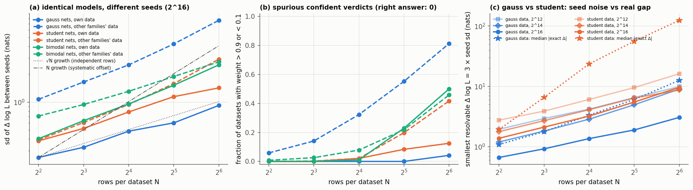

# C9 — can network seeds alone produce a model-comparison verdict?

Status: **done** (2026-10-14). It uses the 27 B5/B6 networks (3 families × 3 budgets ×
3 seeds; a seed controls training data *and* initialisation), their best-validation
checkpoints, and the full `compare()` pipeline.

Scripts:

- `analyze_swap.py`: true-θ swap test, seed spread vs model gap, and checkpoint rule,
  all from stored per-row log p (no new network evaluation);
- `run_best_checkpoint.sh`: evaluates the best-validation checkpoints;
- `pipeline_swap.py`: the swap test through `ModelTransfuser.compare`.

## E-C9.3 swap test: identical models, different seeds

Two seeds of the same family are two "models" with equal parameter counts, so the
Akaike weight is sigmoid(Δ log L). The right answer is 0.5.

| setting (2¹⁶ sims) | N = 16: sd of Δ log L | N = 16: confident verdicts | N = 64: confident |
|---|---|---|---|
| Gaussian nets, Gaussian data | 0.49 | 0% | 4% |
| Student-t nets, Student-t data | 0.79 | 2% | 12% |
| bimodal nets, bimodal data | 0.96 | 1% | 50% |
| Gaussian nets, *other families'* data | 1.9–3.2 | 18–47% | 67–96% |

"Confident" means one copy gets an Akaike weight above 0.9 or below 0.1.

- **On their own family's data and at moderate N, seeds do not fabricate verdicts.**
  The spread grows with N roughly like √N for the Gaussian family and faster for the
  others (heavy-tailed per-row differences).
- **Large N or less data produces fake verdicts.** At 2¹² simulations, 16-row datasets
  already give 21–29% confident verdicts.
- **On misspecified data (rows from another family), two copies of the same model
  disagree strongly.** 47% of 16-row comparisons of two Gaussian networks on bimodal
  data are "decisive". When the true model is not among the candidates, which is the
  normal case, a verdict partly reflects which seed was trained.
- **The full `compare()` pipeline** (posterior sampling, MAP, MLE, AICc; Gaussian
  2¹⁶, seeds 0 vs 1, 16 datasets × 16 rows):
  - P(seed 0) ranged 0.34–0.63, with no confident verdict.
  - The spread of Δ log L at the MLE is 0.30, smaller than at the true θ: fitting θ
    absorbs part of each network's error.
  - But the mean P is 0.454 (2.3 SE below 0.5): seed 1 is systematically favoured by
    ≈ 0.011 nats/row. A per-seed offset grows like N, so at N ≈ 250 it alone would give
    one of two identical models a confident verdict.

## E-C9.1 seed spread vs a real model gap (Gaussian vs Student-t)

The seed sd of the dataset Δ log L comes from all 3 × 3 seed combinations; the smallest
resolvable gap is taken as 3 × seed sd.

| budget | N = 16: resolvable gap | median exact gap (Gaussian data) | datasets resolved | sign agreement |
|---|---|---|---|---|
| 2¹² | 4.2 nats | 3.3 | 28% | 91% |
| 2¹⁴ | 2.9 nats | 3.3 | 56% | 93% |
| 2¹⁶ | 1.4 nats | 3.3 | 88% | 95% |

On Student-t data the gaps are much larger (median 24 nats at N = 16) and are resolved
anyway. The Gaussian network's over-generosity on outliers (B6.3, a +36-nat bias per
16 rows) does not flip them.

## E-C9.2 checkpoint rule

| family | budget | final-epoch RMSE | best-validation RMSE |
|---|---|---|---|
| Gaussian | 2¹⁶ | 0.111 ± 0.002 | 0.183 ± 0.034 |
| Student-t | 2¹⁶ | 0.168 ± 0.011 | 0.214 ± 0.032 |
| bimodal | 2¹⁶ | 0.188 ± 0.035 | 0.264 ± 0.068 |

All budgets are in `results/swap_and_gap.md`.

- **The best-validation checkpoint is 30–70% worse in every family and budget**, and
  its seed spread is larger.
- The checkpoint is written in the optimiser's eval mode, so this is not a weight-mode
  artefact. The validation DSM loss (fresh t and ε each epoch) is too noisy to select
  on, and the final model has trained ≥ 40 epochs (the early-stopping patience) longer.
- **Library consequence (fixed).**
  - `ModelTransfuser.train_models` reloads `{name}.pt`, which single-GPU training never
    wrote (only the worse `{name}_checkpoint.pt`). The Trainer now also saves the
    final-epoch model as `{name}.pt`.
  - It first calls `optimizer.eval()`: schedule-free AdamW's averaged weights are only
    active in eval mode, and without validation data the model used to end on raw
    training weights.
  - Tests are in `validation/tests/test_final_checkpoint.py`.

## Consequences for using COMPASS as a comparison tool

1. **Report the seed spread.** Train each candidate with ≥ 2–3 seeds, and treat a ΔIC as
   resolved only if it exceeds ~3× the seed sd of that ΔIC.
2. **Use the final-epoch model, not the best-validation checkpoint.**
3. **Be most careful about misspecified candidates.** Their networks disagree with each
   other and are over-generous (B6.3). This is the B7 problem.
4. **The minimum budget** for 16-row decisions at the ~1.5-nat level is about 2¹⁶
   simulations per model (for these 2-parameter, 3-observable problems).
