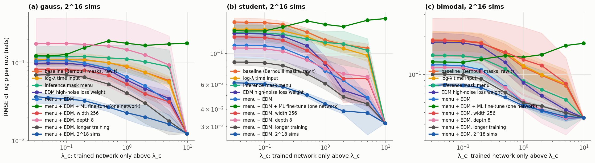
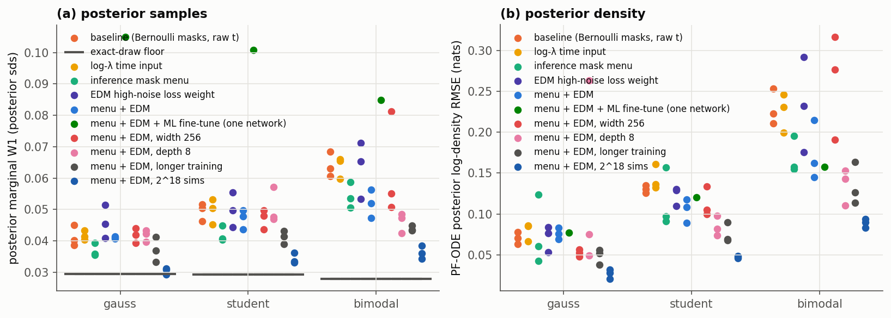

# Improving the PF-ODE likelihood without hurting the rest of COMPASS

Status: **done** (2026-10-14). Four arms × 3 families × 3 seeds = 36 trained networks.

## Which lever, and why this one (the first hypothesis; it failed, see Results)

B5/B6 located the trained network's log-likelihood error. It does not come from the
low-noise band. It builds up over λ > 0.2 and is largest at λ > 5, where the
log-density integrand is most sensitive to small score errors.

The cheapest lever that targets this is the **diffusion-time input**:

- The DiT-style sinusoidal `TimestepEmbedder` has frequencies ≤ 1 and was designed for
  integer timesteps up to ~1000.
- COMPASS passes t ∈ (0.001, 1], so every embedding argument is below 1.
- The top band λ ∈ [5, 9.8] is squeezed into t ∈ [0.79, 1], and the whole band
  λ < 0.2 into t < 0.036.

`time_embedding="log_lambda"` (new, opt-in, `ScoreBasedInferenceModel`) feeds
τ = 1000 · (log λ(t) − log λ_min) / (log λ_max − log λ_min) instead:

- noise levels are spread evenly over the embedder's design range;
- no new parameters, no new loss, no inference-time cost;
- it is a forward pre-hook, so every call site is unchanged;
- it is stored in the checkpoint; the default stays `"raw"` and old checkpoints
  round-trip byte-for-byte.

Alternatives considered and not tried first:

- **High-noise time-sampling weight:** trades directly against the low-λ accuracy that
  `log_sigma` was chosen for (memory: 3× better posteriors), so it risks the rest of
  COMPASS.
- **Gaussian residual parameterisation:** larger effect on composed fields (memory:
  10–31×), but needs a base score per mask.
- **Fitted-Gaussian endpoint:** already shown to be worse with trained networks (B5).

## Test (later arms: inference mask menu, EDM loss weight, both)

- Retrain the 2¹⁶ networks (3 families × 3 seeds), identical in everything but
  `time_embedding`, and evaluate them with the B6 pipeline.
- "Without hindering" is checked on the posterior (`posterior_check.py`, 64 test
  observations, exact grid posteriors):
  - samples: mean error, sd ratio and marginal W1 in posterior sds, against the
    exact-draw floor;
  - the PF-ODE posterior density at the true θ.

## Predictions (written before the results)

1. Likelihood RMSE at 2¹⁶ falls by ≥ 20% in every family. The gain shows in the
   band-attribution curve at λ > 0.2.
2. The posterior is unchanged within the seed spread. A worse low-λ posterior would
   falsify "without hindering".
3. Seed-to-seed spread of the likelihood (C9) shrinks at least as much as the RMSE.

## Results

All arms: 2¹⁶ simulations, 3 seeds each (seed controls data and initialisation),
identical architecture and everything else; B6 evaluation and posterior checks on the
same test rows. `results/summary.md` has every number.

| family | arm | log p RMSE | bias | seed-swap sd/row | posterior W1 (floor) | posterior density RMSE |
|---|---|---|---|---|---|---|
| Gaussian | baseline | 0.111 ± 0.002 | −0.032 | 0.125 | 0.041 (0.030) | 0.071 |
| | log-λ input | 0.111 ± 0.016 | −0.013 | 0.138 | 0.042 | 0.079 |
| | mask menu | 0.121 ± 0.032 | −0.056 | 0.121 | **0.037** | 0.076 |
| | EDM weight | **0.098 ± 0.005** | −0.021 | 0.112 | 0.046 | 0.071 |
| | **menu + EDM** | 0.105 ± 0.012 | **+0.002** | **0.088** | 0.041 | 0.076 |
| Student-t | baseline | 0.168 ± 0.011 | −0.045 | 0.185 | 0.049 (0.029) | 0.130 |
| | log-λ input | 0.149 ± 0.009 | −0.016 | 0.175 | 0.050 | 0.143 |
| | mask menu | 0.141 ± 0.016 | −0.051 | 0.145 | **0.042** | 0.115 |
| | EDM weight | 0.139 ± 0.021 | −0.006 | 0.150 | 0.050 | 0.123 |
| | **menu + EDM** | **0.114 ± 0.016** | **−0.004** | 0.150 | 0.047 | **0.105** |
| bimodal | baseline | 0.188 ± 0.035 | −0.038 | 0.213 | 0.064 (0.028) | 0.229 |
| | log-λ input | 0.184 ± 0.027 | −0.032 | 0.207 | 0.064 | 0.225 |
| | mask menu | 0.142 ± 0.030 | −0.024 | 0.171 | 0.054 | 0.169 |
| | EDM weight | 0.181 ± 0.031 | +0.008 | 0.203 | 0.063 | 0.233 |
| | **menu + EDM** | **0.119 ± 0.012** | +0.015 | **0.148** | **0.052** | **0.174** |





### Verdict per prediction

1. **Log-λ time input: falsified.** It has no effect on the Gaussian family, in any
   noise band, and −11% on Student-t only. The network already resolves the noise
   level, so time resolution was not the bottleneck. The option stays opt-in
   (`time_embedding="log_lambda"`) and off by default.
2. **"Without hindering": held for the recommended recipe.** Menu + EDM is equal to or
   better than the baseline posterior in every family (W1 0.041 / 0.047 / 0.052 vs
   0.041 / 0.049 / 0.064; density 0.076 / 0.105 / 0.174 vs 0.071 / 0.130 / 0.229).
   - EDM *alone* costs some posterior accuracy (Gaussian W1 0.046; its worst bimodal
     seed 0.071).
   - The menu alone improves the posterior everywhere.
3. **Seed spread: shrinks** with menu + EDM (Gaussian 0.125 → 0.088, bimodal
   0.213 → 0.148).

### Why the two levers combine

- **EDM weighting** (ε-loss × (1 + σ²/σ_data²)) puts training signal where B5 located
  the error, λ ≈ 0.5–5 (band figure). It also **removes the systematic low bias** in
  every family (to |bias| ≤ 0.02). The ε-loss weights denoiser errors by 1/σ², so the
  unweighted network was left under-trained exactly where the log-density integrand is
  most sensitive.
- **The inference mask menu** (1/3 posterior mask, 1/3 likelihood mask, 1/3
  Bernoulli) gives the two directions `compare()` uses about 10–20× more direct
  training. Under Bernoulli(0.33) the exact likelihood mask is drawn 3.3% of the time
  and the posterior mask 1.6%. It helps most on the non-Gaussian families and on the
  posterior.
- They act on different bands, so the gains add: −32% / −37% on Student-t / bimodal.
  The Gaussian family was already the easiest; its −5% is within the seed spread, but
  its bias and seed spread both improve.

### Effect on model comparison (B6.3 quantities, Gaussian vs Student-t networks)

| arm | Δ error, Gaussian data (robust sd/row) | Δ error, Student-t data | 16-row decision agreement |
|---|---|---|---|
| baseline | 0.117 | 0.156 | 94.8% / 97.9% |
| mask menu | 0.079 | 0.109 | 95.8% / 99.0% |
| EDM | 0.095 | 0.132 | 97.9% / 100% |
| menu + EDM | 0.089 | 0.124 | 96.9% / 99.0% |

The wrong model's over-generosity on out-of-range data (+2.0 to +2.2 nats/row on
Student-t data) is **unchanged by every arm**. Better training does not teach a network
about observations it never sees; that remains B7.

### Recommendation

Train models meant for comparison with

```python
model.train(theta, x, ..., time_sampling="log_sigma",
            mask_menu="inference", mask_roles=<number of theta dims>,
            time_loss_weight="edm")
```

- Both options are opt-in; defaults are unchanged.
- `mask_menu="inference"` is new (it builds the `ConditionalMenu` used here).
  `time_loss_weight="edm"` is new in `Trainer`/`SBIm.train`.
- Making them the default would change every future training run. That is your call,
  and it should be checked on a hierarchical model (Partial_Pooling) first: the menu
  here covers only flat θ/x models, and hierarchical models use the "six" menu.
- Not yet tested: whether the gains hold at smaller budgets (2¹²–2¹⁴), and EDM's
  `sigma_data` (fixed at 1).


## Follow-up (2026-10-15): maximum-likelihood fine-tuning of the single network, a negative result

**Question.** Can the one network be made more precise by also training it on the
PF-ODE log-likelihood itself (`finetune_ml.py`)?

- Objective: the unchanged DSM loss (menu + EDM) + NLL of log p(x | θ) + NLL of
  log p(θ | x).
- Data: simulations only.
- Selection: held-out simulations, with the held-out DSM loss guarded to within 2%.

**A loophole found first.** With the score-based t = 1 endpoints ("isotropic" /
"gaussian"), the endpoint term uses the network's own score.

- The optimiser lowered the held-out NLL to 3.42 on the bimodal family, *below* the
  exact 4.042. A normalised density cannot do that (Gibbs' inequality).
- Fixed with `endpoint="fixed"`: a network-independent base N(m, λ_max² + v) with
  stored data moments (`SBIm.set_base_moments`).
- The PF-ODE log p is then a normalised flow density for any weights.
- Tests: `validation/tests/test_fixed_endpoint.py`.

**Result (seed 0, 1500 steps, best held-out step).**

| family | held-out NLL gap to exact (start → best) | log p RMSE: menu + EDM → fine-tuned | posterior W1 | posterior sd ratio |
|---|---|---|---|---|
| Gaussian | 0.022 → 0.002 | 0.111 → 0.124 | 0.041 → 0.105 | 1.03 → 1.10 |
| Student-t | 0.025 → 0.007 | 0.116 → 0.145 | 0.050 → 0.101 | 1.03 → 1.08 |
| bimodal | 0.019 → 0.007 | 0.118 → 0.126 | 0.052 → 0.085 | 1.02 → 1.07 |

- The *average* density moved to the truth: the KL part of the NLL almost vanished.
- Per-row precision got **worse** in every family.
- Posterior sampling **broke** (7–10% too wide, 2× the W1 error), although the
  held-out DSM loss rose by only ~1%. The DSM guard is not a sufficient protection.
- Fitting the flow density pulls the score field in directions DSM barely penalises
  but the SDE sampler follows.

**Verdict.** Not usable with one shared network: it violates "without hindering the
rest of COMPASS". `endpoint="fixed"` stays available (opt-in) because it is the
correct, normalised choice whenever a PF-ODE likelihood is *optimised*.

**Where the precision ceiling is now, for one network.**

- Per-row log p RMSE is ≈ 0.11–0.12 nats at 2¹⁶ simulations with menu + EDM. The mean
  is already within ~0.005 of exact, so what is left is per-row scatter.
- Inference settings (steps, Hutchinson probes, eps, endpoint) no longer matter at
  this level (B6).
- The remaining levers change *training*: more simulations (error ∝ N^−0.45 in B6, so
  2¹⁸ should give ≈ 0.06) and capacity / training length. Neither touches the API or
  the rest of COMPASS.

## Follow-up (2026-10-18): capacity, training length and data on the single network

All arms use menu + EDM and 3 seeds. Log p RMSE is in nats/row (seed mean ± sd); the
posterior W1 floor is ≈ 0.03.

| arm | Gaussian | Student-t | bimodal | epochs trained | posterior W1 (G / S / B) |
|---|---|---|---|---|---|
| menu + EDM (2¹⁶, patience 40) | 0.105 ± 0.012 | 0.114 ± 0.016 | 0.119 ± 0.012 | ~50–120 | 0.041 / 0.047 / 0.052 |
| **longer training** (patience 100, ≤ 1500 epochs) | **0.070 ± 0.014** | **0.087 ± 0.004** | **0.101 ± 0.005** | 125–354 | **0.037 / 0.041 / 0.044** |
| **2¹⁸ simulations** | **0.037 ± 0.005** | **0.062 ± 0.002** | **0.082 ± 0.002** | 81–120 | **0.030 / 0.034 / 0.036** |
| depth 8 | 0.175 ± 0.139 | 0.109 ± 0.015 | 0.114 ± 0.003 | 80–132 | 0.042 / 0.051 / 0.046 |
| width 256 | 0.082 ± 0.012 | 0.131 ± 0.004 | 0.185 ± 0.067 | 53–139 | 0.042 / 0.047 / 0.062 |
| exact-score solver floor | 0.012 | 0.032 | 0.045 | — | — |

Findings:

1. **The networks were under-trained.**
   - Early stopping on the noisy validation loss (patience 40; COMPASS's default is
     *20*) halts after ~50–120 epochs.
   - With patience 100 the same networks train 125–354 epochs and improve by 15–33% in
     log p, with a better posterior. The only cost is compute.
   - It is the same mechanism as C9.2: the validation DSM loss is too noisy to stop on.
2. **Data is the strongest lever.**
   - 2¹⁸ simulations give −65 / −46 / −31%, and the best posterior of all arms. The
     Gaussian posterior samples reach the exact-draw floor.
   - These networks also stopped after 81–120 epochs, so they are probably
     under-trained as well.
3. **Architecture is not a reliable lever at this budget.**
   - Depth 8 was unstable: one Gaussian seed failed badly (sd 0.139).
   - Width 256 helped Gaussian (−22%) but hurt Student-t and bimodal. It stopped
     earliest (53–92 epochs), so width is confounded with under-training. Testing it
     fairly needs the longer schedule.
4. **The solver floor now matters.**
   - At 2¹⁸ the bimodal error (0.082) is under 2× its exact-score floor (0.045). That
     floor is the isotropic-endpoint bias of the default VESDE (λ_max = 9.8; B5:
     +0.039 nats).
   - The persistent bimodal bias (+0.03) is that floor showing through, not a network
     error.
   - B5 showed λ_max ≈ 33 (`sigma=100`) with 400 steps brings the floor to ≈ 0.001–0.004.
     This is a training-time SDE choice (a retrain), not an API change.

Recommended for precise likelihoods with one network:

- menu + EDM;
- train longer (patience ≥ 100);
- as many simulations as affordable.

Next, untested:

- 2¹⁸ + longer training;
- width 256 + longer training (a fair width test);
- `sigma=100` VESDE with 200–400 PF-ODE steps, once the network error approaches the
  floor.
